# Reading a blood-pressure monitor with 10,000 parameters

I log my blood pressure, and the monitor has no Bluetooth: just a backlit LCD. **BP Log** is a
small web app for my phone: take a photo of the display, and it reads systolic, diastolic and
pulse, offline, in under 0.3 s on my phone. No cloud OCR, no account, and nothing leaves the phone.

This README is also the write-up of how the reader got from **40% to 91%** of photos read fully
correctly. It took a set of rules for finding the numbers, plus a tiny neural network
(10,123 parameters, 54 KB) trained only on generated digits.

| | |
|---|---|
| Whole readings fully correct (55 real photos) | 40% → **91%** |
| Single digits, held-out test half | 95.7% (rules) → **99.5%** (network) |
| Network size | 10,123 parameters, 54 KB file, plain JavaScript, no libraries |
| Time per photo | 268 ms on an Android 10 phone, 173 ms in desktop Chrome; the network costs about 1 ms per digit |
| Training | ~42 s on Apple MPS (5.6× faster than CPU) |
| Real test data | [chakibmed/bp-monitor-seven-segment](https://huggingface.co/datasets/chakibmed/bp-monitor-seven-segment) on Hugging Face |

<table>
  <tr>
    <td align="center">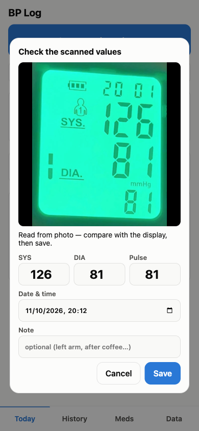<br><sub><b>Scan</b>: values read from the photo, ready to check</sub></td>
    <td align="center">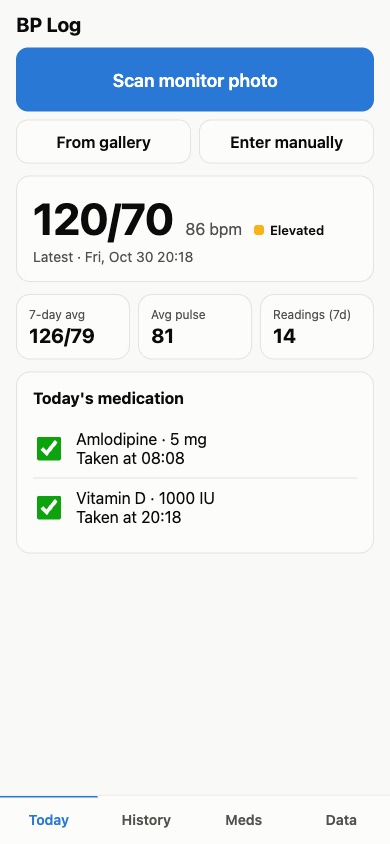<br><sub><b>Today</b>: latest reading, 7-day average, medication</sub></td>
    <td align="center">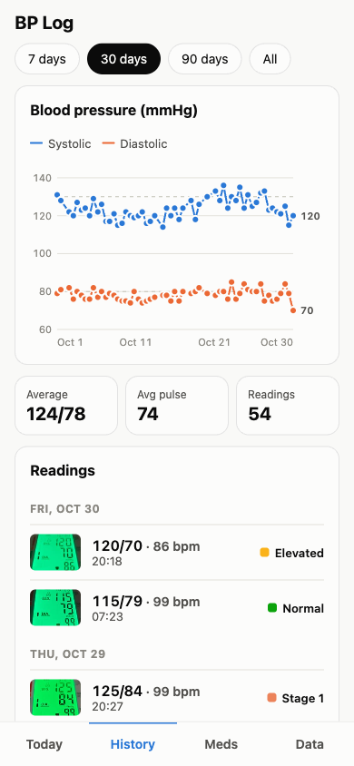<br><sub><b>History</b>: chart and readings with their scans</sub></td>
  </tr>
  <tr>
    <td align="center">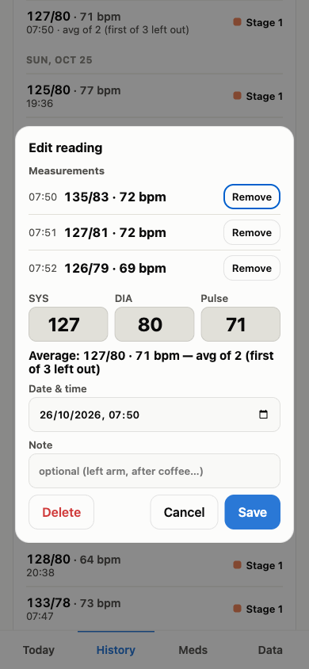<br><sub><b>Averaging</b>: 3 measurements, the first left out</sub></td>
    <td align="center">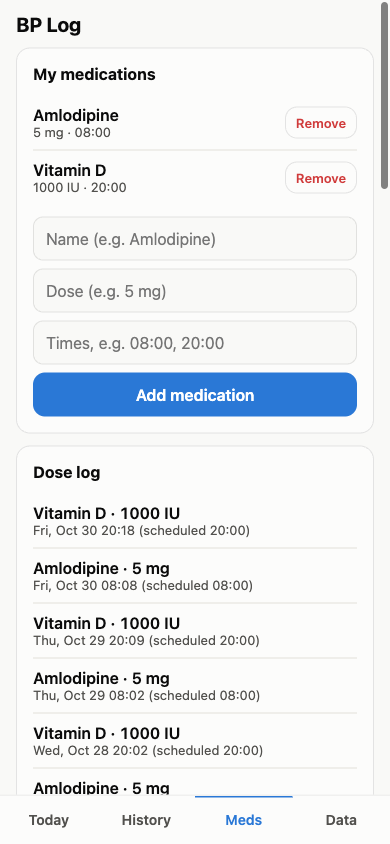<br><sub><b>Meds</b>: schedule and dose log</sub></td>
    <td align="center">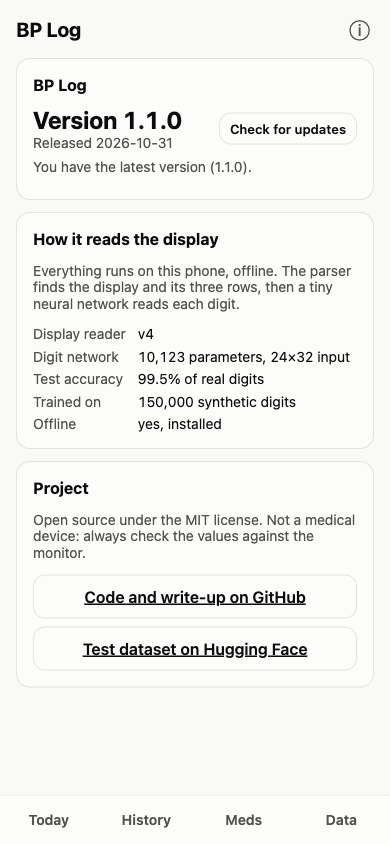<br><sub><b>About</b>: version and update check</sub></td>
  </tr>
</table>

<sub>The chart, averages, medications and older history are synthetic demo data
(`docs/demo-seed.js`). The display thumbnails on the latest readings and the scanned photo are
real.</sub>

---

## 1. The problem

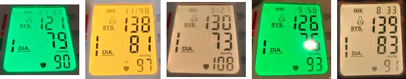

*Real scans from the app (160 px versions). The backlight is green, yellow or beige depending on
the reading. Some photos have glare (4th) and the pulse is often much fainter than the rest.*

General OCR engines (Tesseract, for example) are trained on printed text and read seven-segment
digits badly: an "8" made of separate bars doesn't look like any printed font. The display only
ever shows three numbers in a fixed layout, so a dedicated reader is simpler and more reliable.

## 2. How the reader works

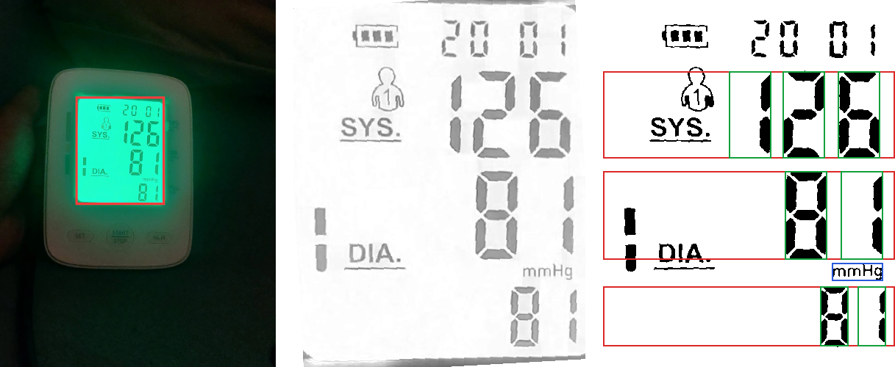

*Left: the lit display found in the photo. Middle: each pixel compared with its local background.
Right: black-and-white mask, with the chosen rows (red), the "mmHg" anchor (blue) and the digit
cells (green).*

1. **Find the display.** It's the largest bright blob in the photo.
2. **Compare every pixel with its local background.** The background comes from a grey-level
   closing (a max filter then a min filter, wider than a segment stroke). That removes uneven
   backlight and vignetting, and works for any backlight colour. A plain global threshold fails on
   the saturated green photo below.
3. **Straighten the photo.** It tries tilts from −15° to +15° and keeps the one where horizontal
   edges line up best.
4. **Choose the three rows.** Each candidate (systolic, diastolic, pulse) triple is scored:
   - systolic and diastolic must be the same height, and the pulse about ¾ of that,
   - each row near its usual position on the display,
   - the printed "mmHg" label, when found, between diastolic and pulse,
   - no tall ink left over outside the chosen rows.

   Rows that touch can be split, and the clock line at the top is ignored.
5. **Cut out the digits.** Split each row into digit boxes, keep the right-aligned group (dropping
   the heart icon or memory number), and trim each box to its digits.
6. **Read each digit** with the neural network (section 4). If it isn't confident, fall back to
   checking which of the 7 bars are lit. If a row still makes no sense (systolic outside
   60–260, systolic not above diastolic, …), retry that row at several threshold levels.

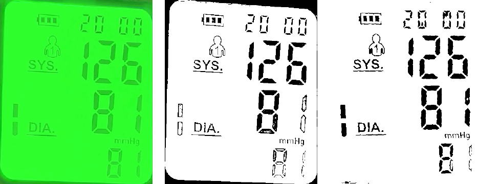

*Left: a saturated green photo. Middle: one global threshold leaves hollow outlines and keeps the
bezel. Right: comparing against the local background gives solid segments.*

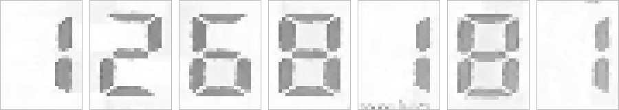

*What the network actually sees: 24×32 crops of each digit cell, as "ink" relative to the local
background. A "1" sits on the right side of its box, as on the display.*

## 3. Measuring it on real photos

Every scan the app saves keeps an image of the display, the values I confirmed, and what the
parser first read. So an app backup doubles as a labelled test set. `node test/eval.mjs
backup.json` re-runs the parser on all of them. The results below use **55 photos**: 53 scans
from a backup (stored at 160 px, harder than the full photo the app reads) and 2 full-size
photos.

Each step was driven by looking at the failures:

| Step | All 3 right | Main fix |
|---|---|---|
| First version | 40% | "three tallest rows" + 7-bar check |
| Row scoring with layout rules | 58% | rows that touch, the clock taken as a row, solid-filled small digits, rows of only "1"s |
| Clock ignored, rows trimmed, bezel edge dropped | 71% | the clock leaking into systolic, misplaced bar positions |
| Pulse bottom edge kept, heart icon dropped | 73% | pulse digits cut off at the display edge |
| Per-row threshold retries + "systolic > diastolic" | 82% | faint pulse digits |
| Two typos fixed in my own labels | 85% | *(the photos showed 94 and 130)* |
| **Neural digit reader** | **91%** | broken and faint digits |

*The first row was measured on the 53 backup scans only; later rows include the 2 full-size
photos. The labelling typos were found because the parser kept "getting them wrong".*

## 4. A tiny neural network for the digits

The rules got most digits right, but faint, hollow or broken segments still tripped the 7-bar
check. A classifier fixes that, but I only had about 390 labelled real digits, all from one
monitor, with few examples of 4, 5 and 6. So the network is trained **only on generated digits**,
and the real ones are used purely to test it.

**The generator** ([train/common.py](train/common.py)) draws seven-segment digits in random
"display fonts" and then damages them:
- **Font:** bar thickness, gaps between bars, slant, bevelled or square ends.
- **Display:** filled or hollow bars, faint "off" bars, the optional tails on 6, 7 and 9.
- **Photo:** blur, noise, glare, uneven background, contrast.
- **Surroundings:** neighbouring digits, text such as "mmHg" poking into the crop.
- **Pipeline errors:** boxes that are slightly off.

There's also an 11th class, "not a digit", for icons, specks and misplaced boxes.

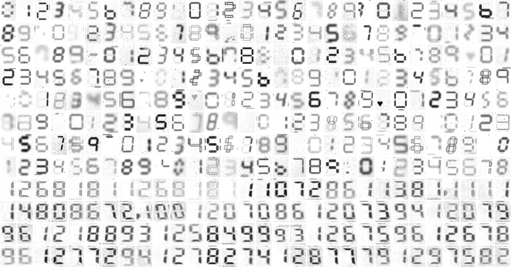

*Top 8 rows: generated training samples. Bottom 4 rows: real digits from my scans, never used for
training.*

**The network** is 3 × (3×3 conv → ReLU → 2×2 max-pool) with 8, 16 and 32 channels, then one
linear layer: **10,123 parameters**, about 0.5 million multiply-adds per digit. It's trained in
PyTorch on 150,000 generated samples for 15 epochs (AdamW, one-cycle learning rate, label smoothing), then exported as base64 float32 weights.
The browser runs it with a ~60-line forward pass in [digitnet.js](digitnet.js).

| Layer | Output (channels × height × width) | Parameters |
|---|---|---|
| Input: ink map of one digit cell | 1 × 32 × 24 | – |
| Conv 3×3, 1 → 8, ReLU, max-pool 2×2 | 8 × 16 × 12 | 80 |
| Conv 3×3, 8 → 16, ReLU, max-pool 2×2 | 16 × 8 × 6 | 1,168 |
| Conv 3×3, 16 → 32, ReLU, max-pool 2×2 | 32 × 4 × 3 | 4,640 |
| Flatten, dropout 0.2 (training only), linear 384 → 11 | 11 | 4,235 |
| **Total** | | **10,123** |

This is the second version of the network. The first one, and the trade-offs behind both, are in
[Two versions, and keeping it simple](#two-versions-and-keeping-it-simple).

**A fair test.** The real digits are split by photo into a *dev* half, which I looked at while
tuning the generator, and a *test* half, used only for the final number. Both halves, the 55
readings and the 388 digit crops, are published as a dataset:
[chakibmed/bp-monitor-seven-segment](https://huggingface.co/datasets/chakibmed/bp-monitor-seven-segment).

### Accuracy

| Real digits | 7-segment rules | DigitNet (PyTorch) | DigitNet (JavaScript) |
|---|---|---|---|
| dev half (201 digits) | 96.0% | 98.5% | 98.5% |
| **test half (187 digits)** | 95.7% | **99.5%** | **99.5%** |

| Whole readings (55 photos) | Rules only | Rules + DigitNet |
|---|---|---|
| Systolic | 93% | 95% |
| Diastolic | 93% | 98% |
| Pulse | 87% | 93% |
| **All three right** | 85% | **91%** |
| All three right, stress test¹ | 73% | **83%** |
| Nothing read at all | 2 | 0 |

¹ 440 cases: every photo plus rotated (±4°, ±8°), shrunk, dimmed and heavily recompressed copies
(`node test/eval.mjs --augment`).

### Python vs JavaScript

The JavaScript forward pass and PyTorch give **the same prediction on all 388 real digits**, and
their probabilities differ by at most 1.8 × 10⁻⁶ (float rounding). The accuracy numbers above are
therefore identical in both.

### Speed

**Training** (150,000 samples per epoch, batch 256, Apple M5, PyTorch 2.15):

| Device | Time per epoch | Full run (15 epochs) |
|---|---|---|
| CPU | 15.8 s | ~4 min |
| **MPS (Apple GPU)** | **2.8 s** | **~42 s** |

**Reading digits with PyTorch.** For a model this small the GPU only pays off on big batches:

| Device | One digit at a time | Batch of 388 |
|---|---|---|
| CPU | **0.14 ms** per digit | 0.018 ms per digit |
| MPS | 0.25 ms per digit | **0.003 ms** per digit |

Handing a single tiny input to the GPU costs more than the work itself. The app reads 6–9 digits
per photo, so plain CPU code is the right choice there.

**In the app** (plain JavaScript, single thread):

| Where | Full photo, rules only | Full photo, with DigitNet | DigitNet per digit |
|---|---|---|---|
| Node 26, Apple M5¹ | 148 ms | 152 ms | 0.59 ms |
| Chrome 152 desktop, Apple M5¹ | 163 ms | 168 ms | 0.65 ms |
| **Android 10 phone** (Chrome 156, 8 cores)² | 261 ms | 268 ms | 0.99 ms |

¹ `node test/bench.mjs` and `test/bench.html`: warm-up, then the two variants alternated, medians.

² Median of three runs on a cool phone, the two variants alternated. Memory stayed at 10 MB
before and after every run, and the first run's first two photos were slower (318 and 305 ms)
while the browser compiled the code and the CPU sped up.

At first the phone's times kept climbing run after run, which looked like a memory leak. But
300 runs in Node and repeated runs in desktop Chrome showed flat times and flat memory, and the
phone was back to normal after resting for two minutes: it was **thermal throttling**. Each
benchmark is a few seconds of full-CPU work. Benchmark mobile devices cool, and alternate the
variants you compare. The first benchmark measured one variant after the other, and that alone
made the network look almost free on the phone (2 ms) and three times as costly in Node (18 ms).
Alternated, it costs 4–10 ms per photo everywhere.

Most of the time goes to the image processing (background estimate, deskew). The network costs
about 1 ms per digit on the phone, so 5–10 ms per photo, and a whole photo takes under 0.3 s. To measure
another device, open `test/bench.html` on it and press *Run benchmark*.

### Two versions, and keeping it simple

The first network took **20×32** crops. The three 2×2 poolings halve the width 20 → 10 → 5 → 2,
so the last one silently drops the rightmost column of the 8×5 feature map. Nothing complained:
PyTorch and my JavaScript port both round down the same way, and the accuracy was fine. The
second version uses **24×32** crops (both sides divisible by 8), so nothing is dropped.

| | v1 | v2 (shipped) |
|---|---|---|
| Input crop | 20×32 | 24×32 |
| Feature maps after each pooling | 8×16×10 → 16×8×5 → 32×4×**2** | 8×16×12 → 16×8×6 → 32×4×3 |
| Features into the last layer | 256 (one column dropped) | 384 (nothing dropped) |
| Parameters | 8,715 | 10,123 |
| Weights file | 47 KB | 54 KB |
| Multiply-adds per digit | 418k | 502k (1.20×) |
| Real digits correct, dev / test | 98.5% / 99.5% | 98.5% / 99.5% |
| Whole readings / stress test | 91% / 83% | 91% / 83% |
| Per digit, Node (both in one process, alternated) | 0.50 ms | 0.60 ms (1.21×) |
| Per digit, Android phone | 0.83 ms³ | 0.99 ms |
| Training epoch, CPU / MPS | 13.5 s / 2.3 s | 15.8 s / 2.8 s |

³ A single run, before the cool-phone method above.

**The trade-off:** on this data the two are equally accurate, and v1 is smaller and about 20%
faster. I shipped v2 anyway. A network that throws away part of its input without saying so is a
trap for other monitors, where a digit's right-hand bars could land in exactly that column. It's
also easier to explain and to change. The cost is 1,408 parameters, 7 KB and about 1 ms per
photo on the phone. If size were critical, v1 would be a perfectly defensible choice.

**Kept simple on purpose.** Each of these would help something, and each was left out because
the simple version was already good enough:

| Not used | What it would bring | Why not (yet) |
|---|---|---|
| Batch normalisation | faster, more stable training | training takes 40 s already; it would need folding into the conv weights at export |
| int8 quantisation | weights about 4× smaller (~14 KB) | 54 KB is fine for a web page; adds scaling code and another parity check |
| WebGL / WASM / TensorFlow.js | faster inference | a dependency of hundreds of KB or more, for a model that takes 1 ms per digit in plain JS |
| A bigger network | more capacity | the test set has 1 error in 187 digits, and it's a box problem, not a capacity problem |
| Reading a whole row at once (CRNN + CTC) | would also fix row / digit splitting, now the main source of errors | needs many real labelled rows and a heavier model; single digits are easy to generate synthetically |

Plain conv / ReLU / max-pool / linear layers keep the JavaScript forward pass at about 60 lines,
which can be checked by eye and against PyTorch (388 of 388 identical predictions).

## 5. What's left

- **Finding rows is now the weak spot, not reading digits.** The 5 remaining failures are a glare
  spot over the diastolic, faint pulse rows, and a "1" mistaken for the edge of an icon. The
  layout rules are tuned to my monitor; they are the next thing to generalise.
- **One monitor.** The generator varies fonts widely, but the real test set comes from a single
  device. Testing on public sets (SSDN, the Oxford BP / glucose meter photos) would show how
  well it generalises.
- **Small test set.** 388 digits means one error is about 0.5%. The app keeps saving larger
  (320 px) images plus what the parser first read, so the test set grows with every reading.
- **Always check.** The app outlines implausible values in red, but a confident wrong read is
  still possible. Glance at the numbers before saving.

---

## Using the app

- **Scan**: take a photo of the monitor (or pick one from the gallery). The reader finds the
  numbers; you check and correct them before saving.
- **Automatic averaging**: readings saved within the time set in Data → Settings (default 5 min)
  become one reading. The time comes from the photo's EXIF date, else the file time. With 2
  measurements both are averaged; with 3 or more the first is left out (AHA / ESH home-BP practice).
  The dialog says when a reading will be merged and has a *Keep separate* option. Opening a merged
  reading lists its measurements, each with its photo, and any of them can be removed.
- **Track**: latest reading with its AHA category, 7-day averages, and a history chart and list
  (7 / 30 / 90 days / all). Tap a reading to edit or delete it.
- **Medication**: add meds with their times (e.g. `08:00, 20:00`) and tick them off on the Today
  tab. Every tick is saved in the dose log.
- **Data**: export readings and the dose log as CSV, or everything as a JSON backup. You can import
  both formats again.
- **About** (ⓘ in the header): the installed version, a *Check for updates* button that compares it
  with the published one and installs the update, and what the reader and network are.

Data is stored in the browser's IndexedDB on the phone. Export a backup now and then.

### Run it

It's a static site, so any web server works:

```bash
python3 -m http.server 8766 --directory .
```

Then open http://localhost:8766.

### On Android

The camera works through a normal file picker. Installing to the home screen and offline mode
need **HTTPS**. The easiest way is GitHub Pages:

1. Push this folder to a GitHub repo.
2. Go to Settings → Pages and deploy from the branch root.
3. Open the `https://<you>.github.io/<repo>/` URL in Chrome on Android, then choose ⋮ → **Add to Home screen** (or **Install app**).

#### Without a host: straight from your computer over USB or Wi-Fi debugging

`localhost` counts as a secure context, so the install and offline mode work without HTTPS.
Needs `adb` and USB (or wireless) debugging turned on on the phone.

```bash
python3 -m http.server 8766 --directory .          # serve the app
adb devices                                        # the phone must be listed as "device"
adb reverse tcp:8766 tcp:8766                      # phone's localhost:8766 -> your computer
adb shell am start -a android.intent.action.VIEW \
  -d http://localhost:8766/ com.android.chrome     # open it in Chrome on the phone
```

Unlock the phone, then in Chrome choose ⋮ → **Add to Home screen** (or **Install app**).
After that the app is cached by the service worker and runs offline, so you can stop the
server and unplug. To get a newer version later, repeat the steps and reload the page once
while connected. The stored readings stay in the phone's browser.

Netlify, Cloudflare Pages and similar hosts work too. Only the code is hosted. Your readings never
leave the phone.

### Releasing a new version

Bump `version` (and `date`) in [version.js](version.js). It's the only place the version lives:
the About page shows it, and the offline cache is named after it. Once the new files are served,
*About → Check for updates → Update now* installs them. Otherwise, the phone picks them up on its
own within a couple of app launches. Readings are stored separately and are never affected.

## Reproducing the numbers

Image decoding in the Node scripts uses macOS `sips`.

```bash
node test/eval.mjs                       # whole-reading accuracy on test/fixtures
node test/eval.mjs --no-net              # ... with the 7-segment rules only
node test/eval.mjs --augment             # ... plus rotated / shrunk / dimmed / recompressed copies
node test/eval.mjs bp-backup.json -v     # re-run on every scan in an app backup
node test/eval.mjs bp-backup.json --extract   # save those scans as fixtures (test/fixtures/backup)
node test/bench.mjs                      # speed: rules only vs with DigitNet, alternated

cd train
uv sync                                  # PyTorch, NumPy, Pillow
node export_real.mjs                     # real digit crops -> train/data/real
uv run python train.py                   # train, writes ../digitnet-weights.js
uv run python bench.py                   # CPU vs MPS timings + PyTorch predictions
node parity.mjs                          # JavaScript vs PyTorch on every real digit
uv run python misses.py test             # which test digits are wrong
uv run python make_dataset.py            # rebuild the Hugging Face dataset folder (data/hf)

cd ..
node docs/figures.mjs                    # regenerate the figures in docs/img
```

App screenshots: serve the app, open it at 390×844, run
`(await import('/docs/demo-seed.js')).default(scans)` in the page's console (`scans` is an optional
list of `{ url, sys, dia, pulse }` real display images), reload, and capture each tab.

`test/index.html` runs the parser in the browser and shows the black-and-white image it reads.
`test/bench.html` times it on any device. Fixtures are named `SYS-DIA-PULSE-anything.jpg`.

Photo tips: fill most of the frame with the monitor and avoid strong glare on the display.
Some tilt is fine (about ±10° was tested).

## Files

| File | Purpose |
|---|---|
| `index.html`, `style.css`, `app.js` | the app (tabs, editor, chart, export/import, about) |
| `version.js` | the app version (shown in About, names the offline cache) |
| `ocr.js` | display reader: finds the display, rows and digits (browser + Node) |
| `digitnet.js`, `digitnet-weights.js` | the neural digit reader (forward pass + trained weights) |
| `train/` | synthetic digit generator, PyTorch training, benchmarks ([details](train/README.md)) |
| `test/` | evaluation script, browser test bench and benchmark, sample photos |
| `docs/` | figures for this README and the script that makes them |
| `sw.js`, `manifest.webmanifest`, `icon*` | offline caching and installability |

## License

[MIT](LICENSE): code, trained weights and figures. The app is a personal tracking tool, not a
medical device; always check the values it reads against the monitor's display.
